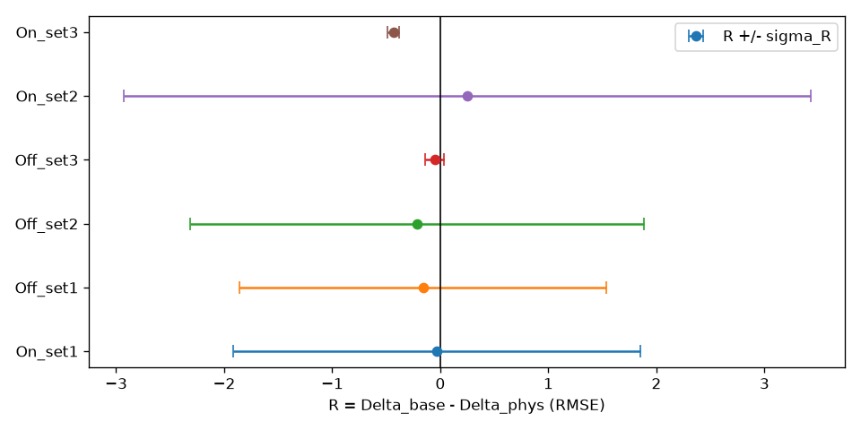

<h1 align="center">struct-x</h1>

<p align="center">
  <a href="LICENSE.md"></a>
  
  <a href="https://www.kaggle.com/code/eros483/struct-x-train"></a>
  <a href="https://github.com/psf/black"></a>
</p>

<p align="center">Replacing event cameras with laser vibrometers</p>

## Abstract

Event cameras watch vibration as a flicker of pixels. Struct-X turns that flicker into the waveform a collocated laser Doppler vibrometer (LDV) would have recorded, and measures whether it stays accurate when lighting or camera settings drift.

To help it, we add a "physics term". This is a penalty that nudges the prediction to ring down like a simple spring-mass-damper (a single damped sine wave) instead of wiggling arbitrarily.

Tested on 30 hammer hits. We train on one lighting setup and test on another, and measure the performance drop "Δ" i.e how much worse the waveform gets under new conditions. The physics term only helps if it shrinks Δ beyond hit-to-hit variation.

The methodology is applied to three models, a baseline RidgeCV, a 3D-ResNet and a space-time TimeSformer.

## Key results

### Physics term ablations

We tested on combinations of encoders and held out data.

On all 8 checks, the drop in Δ is essentially noise and variance among trials, while making same-lighting accuracy slightly worse (+0.1 to +0.5 RMSE).



Full numbers in `results/final_verdict.json`.

### Model performance ablations

All models fail waveform shape (best Pearson r ≈ 0.2 vs target >0.9).

Ridge regression wins on RMSE (RMSE 0.29–0.66 vs deep 0.37–2.6).

## Quickstart

To reproduce the run:

```bash
git clone https://github.com/arnabwithab/struct-x.git
cd struct-x
make setup       # install all required dependencies
make download    # fetch and verify data
make preprocess  # preprocess data
make train       # run model training
make eval        # run model evaluation
make test        # all CI testing
```

## License

- Repo code is MIT License
- the ported TimeSformer is **CC-NC 4.0, research-only**.