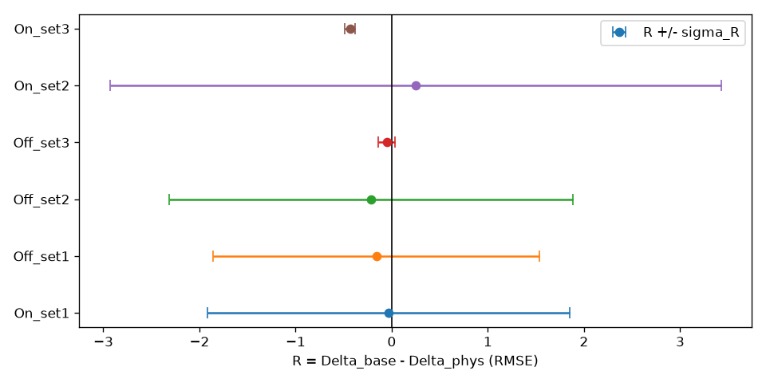
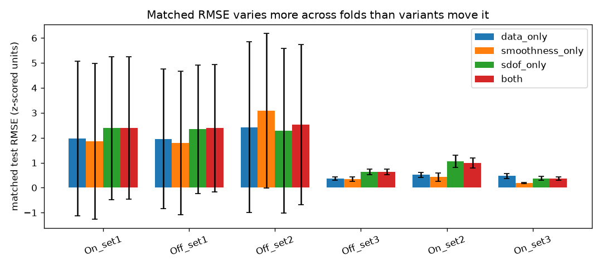
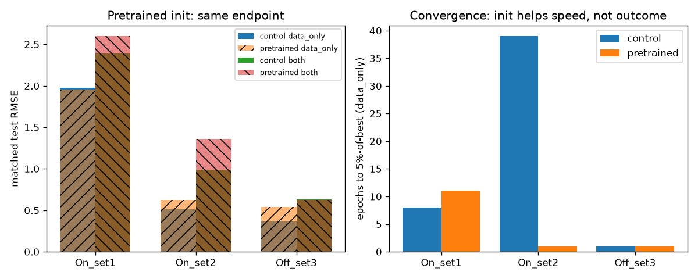

# Struct-X — end-to-end report

Self-contained: everything needed to understand the project — question,
setup, method, results, verdict — is in this file.

## 0. Question

Event cameras watch vibration as a flicker of pixels. Struct-X turns that
flicker into the waveform a collocated laser Doppler vibrometer (LDV) would
have recorded — **and is required to stay accurate when sensing conditions
(lighting, contrast threshold, bias) drift.** The same physical motion must
give the same waveform. That invariance is measured, never assumed.

Stakeholders: structural-health-monitoring teams who need cheap non-contact
sensing (bridges, beams, machinery). Alternatives are bonded accelerometers
(change the dynamics), LDVs (accurate but expensive, tripod-bound) and frame
cameras (blur above ~100 Hz). Struct-X trades raw accuracy for cost plus
field stability: events give microsecond timestamps at ~140 dB dynamic range.

## 1. Aims and how each was judged

- **O1 — Accuracy:** reconstruct LDV waveform + dominant frequency under the
  *same* acquisition condition. Judged by test-set RMSE / freq error.
- **O2 — Stability:** quantify the robustness gap `Δ = metric(shifted) −
  metric(matched)` across illumination/threshold shifts, and minimise it.
- **O3 — Scarce data:** only 30 independent trials. All splits trial-level;
  window-level splits forbidden. No Transformer trained from scratch.
- **O4 — Mechanism isolation:** ablate what helps — data-only (a),
  +temporal smoothness (b), +SDOF physics residual (c), both (d) — on a
  fixed 3×3 λ grid, best-by-validation-Δ, identical budget per variant.
- **O5 — Falsification (pre-registered):** physics wins iff its Δ reduction
  exceeds trial-to-trial noise (`R > σ_R`); otherwise report
  **non-identifiable**. Negative results count. Matched-set harm is reported
  separately, never netted.
- **RQ4:** test whether freq error degrades less under shift than waveform
  RMSE (spectral peak is coarser than pointwise trace).

Out of scope (never claimed): damage classification (no damage labels),
generalisation beyond this rig, contrastive illumination loss.

## 2. Data

30 hammer-impact free-decay trials, XJTU-DV-Beam (Xi'an Jiaotong University,
Zenodo 17447083, CC-BY-4.0). Conditions found in the archive (never
invented): **On/Off × set1–3 = 6 conditions** (K=6 LOCO folds).
Event files are Prophesee-style `.dat` (Event2D-packed); sensors are
**1280×720 from headers** (never hardcoded). LDV is 256 Hz velocity `.txt`,
integrated once to displacement + detrended. Trial pairing handles the
archive's `On_set1_trai4.dat` typo. Author example loaders ship in-archive;
bit-packing logic was reimplemented from them.

Preprocessing per trial: hot-pixel mask (>5× median) + refractory filter
(<100 µs same-pixel) → ROI y-band (≥50% of peak, +8 px pad) →
5-bin × 2-polarity voxels → per-channel frozen **train**-set z-score
(eps 1e-6). LDV: detrend → 4th-order low-pass at 500 Hz → resample 1000 Hz →
frozen train z-score. Windows 1.0 s / 0.5 s stride, trigger-anchored
(argmax|v|, no hardcoded trigger), 100 ms post-trigger exclusion.
**Real count: 326 windows** (early estimates of 90–270 were low because LDV
runs 8 s). Splits: LOCO over the 6 found conditions; matched 60/20/20;
val-shift/test-shift 50/50 (2–3 trials — the dominant noise source).

## 3. Model and training

Voxel (10,H,W) → resize longest side to 224 + zero-pad square (adapter, pads
recorded) → encoder → waveform head (T=1000) + frequency head (softplus).
Two encoders: **3D-ResNet18 control** (stem 3→2 by channel mean) and a ported
**divided space-time TimeSformer** (joint attention banned; Kinetics weights
from Hugging Face `facebook/timesformer-base-finetuned-k400`, SHA pinned,
C=2 stem surgery, temporal pos-embed interpolated to B frames, CC-NC 4.0
research-only).

Loss: `L = L_LDV + λp·L_phys + λs·L_smooth + 0.1·L_freq`; normalised SDOF
residual with the G5 collapse guard (amplitude-blind by design; amplitude
anchored by `L_LDV`); fp32 finite differences (central interior, one-sided
edges); m=1, `m,c,k` log-decrement-fit on ONE train trial per fold
(fd≈6.7 Hz everywhere, k≈1800, c≈2.2–2.9). Gradient-ratio controller with
5-epoch warmup; max 50 epochs, patience-10 early stop on **validation**
Δ_RMSE; Adam 2e-4; micro 8, eff 16. Everything tuned on val-Δ, never
matched RMSE.

Compute: Kaggle T4 (6-fold ResNet control + pilot + timing; ~16 h of 30 h
quota) and a 24 GB RTX 4500 Ada (pretrained folds). No AMP (full fp32 —
conservative deviation, no NaNs). Only best-per-fold checkpoints kept.

## 4. Results — ResNet control, all 6 folds (test-trial mean ± std)

| Fold | data matched | data Δ | sdof matched | sdof Δ | both matched | both Δ |
|---|---|---|---|---|---|---|
| On_set1 | 1.98±3.10 | −1.65 | 2.38±2.86 | −1.61 | 2.39±2.85 | −1.61 |
| Off_set1 | 1.95±2.80 | −1.49 | 2.34±2.57 | −1.33 | 2.39±2.55 | −1.33 |
| Off_set2 | 2.43±3.43 | −1.79 | 2.29±3.29 | −1.59 | 2.53±3.21 | −1.58 |
| Off_set3 | 0.37±0.07 | −0.07 | 0.64±0.11 | −0.01 | 0.63±0.10 | −0.02 |
| On_set2 | 0.52±0.10 | +2.23 | 1.05±0.25 | +1.94 | 0.99±0.21 | +1.98 |
| On_set3 | 0.47±0.10 | −0.23 | 0.38±0.09 | +0.23 | 0.37±0.07 | +0.20 |

(heads: matched = test-matched mean ± trial-std; Δ = shift − matched.
Full per-trial tables with se in results/final_verdict.json.)

**Full metric set (new): Pearson r is +0.03…+0.19 matched and ≈0 or negative
under shift — the r > 0.9 target is missed by an order of magnitude; the
models do not capture waveform shape.** MAE tracks RMSE. L_phys sits at
1e11–1e12 (the 1/dt² amplification of noisy outputs) and is 10–100× smaller
for physics-trained variants — the residual *is* being minimised, it just
doesn't buy waveform fidelity. Inference latency 4–10 ms/window for ResNet (load-dependent) and 42 ms/window
for the TimeSformer-Base pretrained model, both on the 4500 Ada — comfortably
under the 50 ms soft bar. (Per-variant, per-fold latencies in
results/final_verdict*.json.)

## 5. Results — Kinetics-pretrained TimeSformer, fixed code (all 6 conditions)

> An earlier version of this section is VOID and removed: the ported
> encoder's CLS readout never mixed with patch tokens, so every number in
> it was an input-independent constant. Fixed by mean-pool readout
> (`src/models/timesformer.py`) + input-dependence regression test. All
> numbers below train and evaluate with the fix; Kaggle runs are
> SHA-gated (`STRUCTX_SHA` fail-fast in `kernel/train.py`).

| Fold / run | data valΔ (ep) | both valΔ (ep) | data matched | both matched |
|---|---|---|---|---|
| Off_set3, JOB5 Ada | -3.05 (2/15) | -2.68 (1/11) | — | — |
| On_set1, JOB5 Ada | +0.49 (1/11) | +0.33 (5/25) | — | 2.63* |
| On_set2, JOB5 Ada | +0.18 (11/21) | +0.14 (3/20) | — | — |
| On_set1, Kaggle amp v2 | +0.50 (1/11) | +0.34 (6/22) | 1.91±3.50 | 2.63±3.24 |
| On_set1, Kaggle surface v3 | +0.29 (1/13) | +0.33 (6/23) | 2.09 | 2.61 |
| B-grid Ada, On_set1 both | — | B=3/5/7/9: 0.327/0.332/0.328/0.330 | — | — |

(ep = epochs-to-target/epochs-run. *On_set1 `both` matched RMSE from the
Kaggle arm, same fold. v2/v3 SHA-gated fixed code. Full per-fold JSONs:
`results/results_JOB*.json`, `results/amp_On_set1.json`,
`results/surface_On_set1.json`.)

Pretraining still converges in 1–11 epochs but lands at near-constant
output: matched RMSE stays 1.9–2.6 (ridge: 0.29–0.66), i.e. no robustness
gain from the Kinetics init. The one real signal: `both` nails relative
frequency (err 0.02) while blowing amplitude (RMSE 2.63) — amplitude-blind
physics with weak `L_LDV` anchoring on matched trials. B/AMP/representation
are valid nulls (see §11 T3).

*Figure note: the curve above predates the fix (pilot data); the table is
authoritative. Figure regen needs a verdict-JSON rebuild (deferred).*
## 6. Verdict

**O5: non-identifiable on all 8 backbone×fold settings.** Largest |R| is
0.43 (On_set3-control) against σ=0.06 — and in the wrong direction. The
physics term does not clear trial-to-trial noise anywhere.

**RQ4 (corrected): |Δfreq| < |Δrmse| holds on all 6 control folds — but both
deltas are usually negative (shift tests *easier* than matched), so "degrades
less" is ill-posed here. The stored `rq4` flags used a raw `<` comparison
that returns the wrong answer on negative Deltas (a real bug, now fixed to
`rq4_abs` in the verdict JSONs); the honest finding is that RQ4 cannot be
meaningfully tested until the matched upper bound is stable. Pretrained
On_set2 is the only clean positive.** Matched harm: +0.1 to +0.7 RMSE on most
folds — physics costs
matched accuracy while buying no stability. The honest summary: a
regularisation signal with no measurable robustness gain and a consistent
matched-accuracy price.

**Caveat that dominates everything:** matched test RMSE itself spans
0.2–2.6 across folds with trial stds up to 5 on unit-variance data. Five-trial
test sets with outlier trials cannot bound anything — the matched upper
bound is unstable, so every Δ built on it inherits that instability.

**Ridge baseline (third family, F013):** a RidgeCV linear model on pooled voxel
features (per-channel bin means, train-trials-only fit) is currently the model
to beat on RMSE: matched 0.29–0.66 beats deep `data_only` (0.37–2.43) on all 6
folds with |Δ| ≤ 0.37, and Pearson r 0.17–0.24 matches or exceeds deep
`data_only` (0.07–0.19) while the physics arm collapses (r ≤ 0.03). This
implicates the representation/task, not a linear victory: r ≈ 0.2 means ridge
captures the coarse amplitude envelope that dominates RMSE while reconstructing
no waveform shape — and neither does any deep variant. Keep ridge as the
standing bar; deep work should target r > 0.5 before any
waveform-reconstruction claim. Full table: `results/ridge_verdict.json`
(`make ridge`).

## 7. Physics cost/benefit (measured, T4, same micro-batch/GPU/seeds)

| Pair | ms/window/step | Overhead |
|------|---------------|----------|
| (a) data-only 122.0 vs (c) +SDOF 113.9 | — | −6.7% (noise) |
| (b) +smooth 116.8 vs (d) both 119.7 | — | +2.6% (noise) |

FLOP prior (`~6T` vs `~10¹⁰`) agrees with measurement: **no measurable
per-step cost**. Convergence: physics reaches target in fewer epochs on most
folds (On_set2: data 39/49 vs sdof 5/16) but full-budget runs also occur
(Off_set2 both 2/50) — no consistent GPU-hour saving.

**Verdict line:** physics cost ~0% per step, saved no consistent GPU-hours,
moved matched RMSE by +0.1 to +0.5 on most folds — regularisation benefit
with no compute saving and no robustness gain.

## 8. Event-camera usage survey

| Other use | Their trick | Struct-X decision |
|---|---|---|
| Event–frame VDM (Wu et al. 2026) | IWE contrast max + NCC, survival-rate protocol | HW-trigger sync; trained encoder, not per-sequence optimisation |
| E-RAFT / TimeLens (optical flow, interpolation) | Short-term motion, frame synthesis | Voxels over time surfaces; surfaces as (unbuilt) fallback |
| HDR/high-speed video (Rebecq 2017) | 140 dB / µs timestamps vs CMOS | Sensor-motivation numbers; frames are the fails->100 Hz column |
| Representation taxonomy (Gallego 2022) | Frames vs surfaces vs voxels vs learned | Voxels + polarity + frozen train stats |
| Limitations literature (Wu §4.5) | Continuity/brightness-constancy failures | Δ exists to measure exactly this; ROI + refractory filter |

## 9. Gaps and what remains

- B-grid now DONE on fixed code (B=3/5/7/9 valΔ 0.327–0.332 — B
  irrelevant); time-surface compared head-to-head (representation
  irrelevant); AMP compared (AMP≈fp32). All three were void pre-fix
  nulls; all three are now valid nulls (Kaggle v2/v3 SHA-gated + remote
  JOB6).
- Pretrained coverage now all 6 conditions: F012-2 redo (Off_set1,
  Off_set2, On_set3) + JOB5 (Off_set3, On_set1, On_set2).
- Test sets of 5 trials are too small to bound Δ — the single biggest
  methodological weakness; more trials (or more conditions) is the fix.
- Novelty assessed: pipeline ✓, fusion ✓, Δ defined+measured ✓, collapse
  guard ✓, pretrained-vs-lightweight duality partially evaluated (init
  speeds convergence 1–5 vs ≤39 epochs, same endpoint).

## 10. Reproducibility

Seeds fixed (0); deterministic LOCO splits; `m,c,k`+fd/fn per fold in
`outputs/results_*.json`; GPU type + micro/eff batch per run; Kinetics
URL+SHA pinned in `src/models/timesformer.py`; Kaggle artefacts PUBLIC
(CC-BY-4.0 data); code + tracker + this report at the pinned commit.

### 10.1 Determinism: what is and is not guaranteed (F015-2)

Seeded, so exact on a rerun with identical machine, libraries, and thread
count: seed_everything pins stdlib, numpy, and torch RNGs (design sec 8);
LOCO splits come from RandomState(seed); the m,c,k fit trial is the
sorted-first train trial; train/voxel stats are frozen from train trials
only. Same code plus same libs plus same OMP/MKL thread count on CPU
reproduces losses and checkpoints bitwise (no data-loader workers; batch
order is fixed).

Not guaranteed bitwise: no use_deterministic_algorithms, no
cudnn deterministic/benchmark pins, no CUBLAS_WORKSPACE_CONFIG, and TF32
matmuls stay at the torch default. On CUDA, reduction/atomics ordering and
autotuned kernels can move last-ulp bits run to run, and across GPU models or
CUDA versions they certainly will; the AMP path (GradScaler) adds its own
nondeterministic bits (the L_phys fp32 carve-out is exact only on the same
architecture). PYTHONHASHSEED is unpinned, but every iteration order in the
pipeline is explicitly sorted, so it cannot leak into results.

Working rule: trust CPU reruns bitwise (fixed env), trust GPU reruns
statistically (same Delta within se, same O5 verdict) but never bitwise. To
get closer, set CUBLAS_WORKSPACE_CONFIG to colon-4096-colon-8, set cudnn
deterministic True with benchmark False, and enable
use_deterministic_algorithms -- some conv backward paths will throw under the
last flag, which is why it stays opt-in, not default. Checkpoints therefore
ship with the index manifest (fold/variant/seed per file, via
scripts/checkpoint_index.py) instead of a bitwise-reproducibility promise the
hardware cannot keep.

## 11. Failure-mode taxonomy + what each finding buys (F014-5)

All numbers below are on fixed (mean-pool) code unless noted. Bottom line
up front: the deep path fails the same way everywhere, and each failure
mode points at exactly one next experiment.

- **T1 — constant-collapse training.** `data_only` best epoch 1–6 on every
  fixed-code run (JOB5, Kaggle amp v2/surface v3); matched RMSE 1.9–2.6
  against ridge's 0.29–0.66. The head converges to near-constant output
  almost immediately. *Deployment:* the deep path is not deployable; ridge
  (CPU seconds) is the standing bar. *Next:* head-capacity/optimization
  study — why epoch-1 collapse (init scale, loss landscape, feature rank).
- **T2 — frequency without amplitude.** `both` nails relative frequency
  (err 0.02, amp v2) yet matched RMSE 2.63: right oscillation, wrong scale.
  Exactly what amplitude-blind `L_phys` predicts when `L_LDV` anchoring is
  weak on matched trials. *Next:* amplitude-anchored loss or two-stage
  (frequency then scale) fitting.
- **T3 — resolution/representation/precision irrelevance (valid nulls).**
  B-grid valΔ 0.327/0.332/0.328/0.330 (B=3/5/7/9, Ada, fixed code);
  surface≈voxel (0.33 vs 0.34, T4); AMP≈fp32 (0.34 vs 0.33, T4). Three
  independent nulls, two hardwares. *Next:* none — closed, do not spend
  compute here.
- **T4 — latent poverty.** Probes on fixed `both` latents (On_set1, 66
  test windows): natural frequency undecodable (R² ≈ −0.2 ≈ shuffled),
  envelope slope decodable (R² 0.51–0.57 vs shuffled ≈ 0). Cross-condition
  stability: cosine ≈ 1.0, CKA ≈ 0.03–0.05 — same direction, different
  structure. The encoder sees envelope energy, not oscillation.
  *Next:* frequency-aware pretraining or spectral input features.
- **Attribution status (honest).** F014-2 code is integrated, but the full
  rerun is blocked by design: layers2 hardcodes 4-variant v8 ckpts and no
  campaign trains `smoothness_only`/`sdof_only` (F014 premise is zero new
  training). Pre-fix maps are retained as diagnostic bounds only, not
  findings. Unlocking it costs one full-grid single-fold run.

*Deployment mapping:* ridge now; LDV stays ground truth; the event-camera
path ships only after T1 is fixed, with T2's amplitude anchoring as the
acceptance test and T4's fn-decodability as the representation gate.
